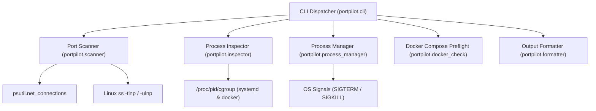

# PortPilot: Linux Port & Process Management CLI

[](https://opensource.org/licenses/MIT)
[](https://www.python.org/downloads/)
[]()

**PortPilot** is a production-quality Linux command-line developer utility designed to detect occupied network ports, identify the processes using them, inspect process metadata, and safely resolve port conflicts before starting local development applications or Docker containers.

```
═════════════════════════════════════════════════════════════════
  PORTPILOT — Linux Port & Process Management CLI
═════════════════════════════════════════════════════════════════
STATUS   PORT    PROTO  SERVICE          PID      PROCESS            ADDRESS         
-----------------------------------------------------------------------------------
[PASS]   5432    TCP    PostgreSQL       -        -                  -               
[FAIL]   6379    TCP    Redis            1420     redis-server       127.0.0.1:6379  
[PASS]   8000    TCP    Django, FastAPI  -        -                  -               
-----------------------------------------------------------------------------------
Found 1 occupied port out of 3 checked.
```

---

## 1. Problem Statement

Developers routinely encounter errors such as:
- `Address already in use`
- `Bind for 0.0.0.0:5432 failed: port is already allocated`
- `Docker cannot bind to the requested host port`
- Forgotten development servers running in background tmux or screen sessions
- System daemons (PostgreSQL, Redis, Apache, Nginx) holding default ports

Resolving these issues historically requires manually juggling commands:
```bash
ss -tulpn
lsof -i :5432
ps aux | grep postgres
kill -15 <pid>
systemctl stop postgresql
```

PortPilot consolidates this entire workflow into a single, intuitive, fail-safe CLI:
**Detect → Inspect → Resolve → Verify → Launch**

---

## 2. Features

- **Non-Invasive Port Scanner**: Local socket table inspection via kernel Netlink / psutil with transparent fallback to Linux `ss` command. No invasive connect-bind probing.
- **TCP and UDP Support**: Differentiates TCP `LISTEN` sockets from UDP sockets and connection states.
- **Wildcard & IPv6 Handling**: Distinguishes `0.0.0.0` (all IPv4 interfaces), `::` (all IPv6 interfaces), and `127.0.0.1` / `::1` loopback listeners.
- **Process Inspector**: Inspects PID, process name, command line, parent PID, user, executable, creation timestamp, systemd service unit, and Docker container ID.
- **Fail-Safe Process Management**:
  - Unconditionally refuses to terminate PID 1 (`init` / `systemd`), PID 0, or PortPilot itself.
  - Mitigates PID reuse race conditions by validating process creation timestamps (`create_time`).
  - Sends `SIGTERM` first, awaits a configurable grace period, checks whether the port was freed, and offers `SIGKILL` only upon explicit escalation.
  - Warns about database processes and systemd-managed services.
  - Never executes `sudo` automatically; strictly avoids `shell=True`.
- **Preflight Docker Compose Verification**: Parses Compose YAML files (short & long syntax, ranges, dynamic ports, UDP, and environment variables) to catch port collisions before containers start.
- **Docker Compose Command Wrapper**: Wraps `docker compose up` with preflight guards, aborting startup if host port collisions exist.
- **Configurable Service Registry**: Built-in definitions for 17 common developer services with support for custom user presets and multiple services per port.
- **Terminal & JSON Output**: Rich ANSI color-coded tables with visual width alignment and pure `--json` output for scripting.

---

## 3. Architecture Overview

PortPilot follows a modular, decoupled architecture:



See [docs/architecture.md](docs/architecture.md) for detailed architecture documentation.

---

## 4. Technology Stack

- **Language**: Python 3.12+ (tested through Python 3.14)
- **CLI Parsing**: Standard library `argparse`
- **Process & Socket Inspection**: `psutil`, Linux `/proc` filesystem, Linux `ss` command
- **Compose Parsing**: `PyYAML`
- **Signal Handling**: Standard library `signal`
- **Configuration**: Standard library `tomllib` & `json`
- **Code Quality**: `Ruff` (linting & formatting)
- **Testing**: `pytest`, `pytest-cov` (102 tests, >86% branch coverage)

---

## 5. Installation

### 5.1 Prerequisites

Ensure Python 3.12 or newer and `iproute2` (for `ss`) are installed.

#### Arch Linux
```bash
sudo pacman -S python python-pip iproute2
```

#### Ubuntu / Debian
```bash
sudo apt update
sudo apt install python3 python3-venv python3-pip iproute2
```

#### Fedora
```bash
sudo dnf install python3 python3-pip iproute
```

---

### 5.2 User / System Installation (via pip or pipx)

Using `pipx` (recommended for isolated CLI tools):
```bash
pipx install .
```

Or standard virtual environment:
```bash
python3 -m venv ~/.local/share/portpilot-venv
~/.local/share/portpilot-venv/bin/pip install .
sudo ln -sf ~/.local/share/portpilot-venv/bin/portpilot /usr/local/bin/portpilot
```

---

### 5.3 Development Setup

Clone the repository and run the automated setup script:
```bash
git clone https://github.com/your-org/portpilot.git
cd portpilot
./scripts/install_dev.sh
```

Or manually:
```bash
python3 -m venv .venv
source .venv/bin/activate
pip install --upgrade pip setuptools wheel
pip install -e ".[dev]"
```

Verify the installation:
```bash
portpilot --version
pytest -v
```

---

## 6. CLI Command Reference

### `portpilot check`
Scans local ports for active listeners.

```bash
# Scan default ports (80, 443, 3000, 3306, 5000, 5432, 6379, 8000, etc.)
portpilot check

# Scan specific ports
portpilot check --ports 5432,6379,8000

# Scan a port range
portpilot check --range 3000-3010

# Scan all ports defined in service presets
portpilot check --services

# Scan UDP ports
portpilot check --protocol udp --ports 53,5353

# Machine-readable JSON output
portpilot check --ports 5432,8000 --json
```

---

### `portpilot inspect <port>`
Displays complete process information for an occupied port.

```bash
portpilot inspect 5432
portpilot inspect 53 --protocol udp
portpilot inspect 8000 --json
```

---

### `portpilot stop <port>`
Safely terminates the process occupying the port after validation and user confirmation.

```bash
# Interactive prompt with safety checks
portpilot stop 5432

# Target a specific PID
portpilot stop 5432 --pid 1420

# Dry-run (simulate action without terminating)
portpilot stop 5432 --dry-run

# Custom grace period before timeout (seconds)
portpilot stop 5432 --timeout 10.0

# Non-interactive confirmation
portpilot stop 5432 --yes

# Direct SIGKILL escalation
portpilot stop 5432 --sigkill
```

---

### `portpilot preflight`
Scans Docker Compose files and flags host-port conflicts.

```bash
# Automatically finds compose.yaml or docker-compose.yml
portpilot preflight

# Specify explicit Compose file
portpilot preflight -f docker-compose.prod.yml

# Output as JSON
portpilot preflight --json
```

---

### `portpilot compose <command>`
Wraps `docker compose` execution with preflight validation guards.

```bash
# Run preflight check before 'docker compose up'
portpilot compose up -d

# Explicit compose file
portpilot compose -f docker-compose.yml up

# Bypass conflict block if necessary
portpilot compose up --force

# Pass-through commands (bypasses preflight)
portpilot compose down
portpilot compose ps
```

---

### `portpilot services`
Lists known development service port conventions.

```bash
portpilot services
portpilot services --json
```

---

## 7. Configuration

PortPilot can be customized using a `config.toml` or `config.json` file located at `~/.config/portpilot/config.toml` or specified via `--config PATH`.

```toml
# Default ports scanned by 'portpilot check'
default_ports = [80, 443, 3000, 3306, 5000, 5432, 6379, 8000]

# Default grace period for SIGTERM (seconds)
termination_timeout = 5.0

# Color enabled (true/false)
color = true

# Default protocol (tcp/udp)
default_protocol = "tcp"

# Custom service conventions
[[services]]
name = "MyAuthService"
port = 9000
protocol = "tcp"
category = "auth"
description = "Internal authentication service"
```

---

## 8. Automated Testing & Code Quality

PortPilot maintains strict automated testing standards with isolated temporary sockets, isolated test processes, and unit mocks. Real system processes are never terminated during test runs.

Run the test suite:
```bash
pytest -v
```

Generate test coverage report:
```bash
pytest --cov=portpilot --cov-report=term-missing
```

Run linter and formatter checks:
```bash
ruff check .
ruff format --check .
```

---

## 9. Security & Reliability Model

- **No `shell=True`**: All subprocess operations use direct token lists to eliminate shell injection vectors.
- **Process Immunity**: PID 1, PID 0, PortPilot, and caller shell processes are immune from termination.
- **PID Reuse Race Prevention**: Validates process creation timestamps immediately before signal transmission.
- **Sensitive Data Masking**: Logs automatically mask passwords, credentials, tokens, and secret keys.
- **Permission Boundary**: PortPilot does not silently invoke `sudo`. When permissions are insufficient, it displays actionable guidance.

See [docs/safety.md](docs/safety.md) for full details.

---

## 10. Known Limitations

- **Non-Root Visibility**: On Linux systems with kernel `hidepid` or strict permissions, non-root users cannot read the PID or command line of processes owned by other users or `root`. PortPilot indicates `<access-restricted>` and advises running with elevated privileges when necessary.
- **Container Namespaces**: Processes executing inside rootless containers or isolated network namespaces are inspected from the host network namespace perspective.

---

## 11. Future Improvements

- Support for eBPF-based socket tracepoints for sub-millisecond ephemeral socket detection.
- Podman Compose CLI integration.
- Optional interactive TUI (Terminal User Interface) dashboard using `curses`.

---

## 12. License

This project is licensed under the terms of the [MIT License](LICENSE).
