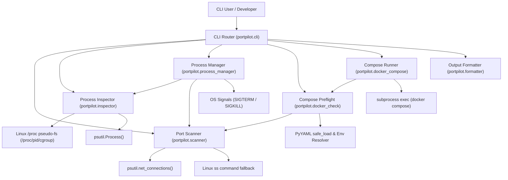
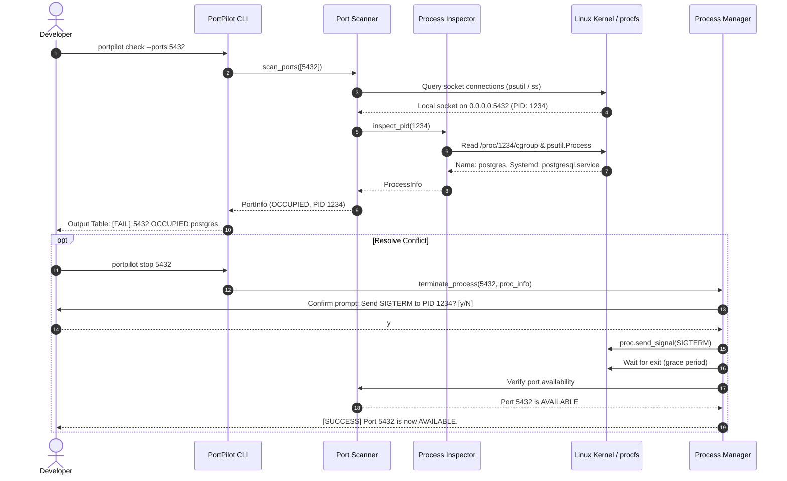

# PortPilot Architecture Documentation

## 1. Architectural Philosophy

PortPilot is engineered under core systems programming principles:
- **Zero Invasiveness**: Inspect sockets without binding or sending arbitrary probe packets.
- **Fail-Safe Process Management**: Process termination is strictly gated by confirmation, non-destructive defaults, PID-reuse race protection, and critical process exemptions.
- **Clean Separation of Concerns**: Strict decoupling between CLI parsing, socket scanning, process inspection, termination logic, and formatting.
- **Defensive Error Handling**: Gracefully handle missing permissions (`EPERM`, `EACCES`), vanished processes (`NoSuchProcess`), and malformed configurations.

---

## 2. Component Architecture

---

## 3. Subsystem Breakdown

### 3.1 Port Scanner (`portpilot.scanner`)
- **Inspection Mechanism**: Uses kernel socket connection tables through `psutil.net_connections()`.
- **Distribution Agnostic Fallback**: If permissions or kernel security restrict `/proc/net/*` or Netlink calls, PortPilot seamlessly executes and parses the Linux `ss` utility (`ss -tlnp` / `ss -ulnp`).
- **Batch Processing**: Sockets are indexed into a hash map in a single pass $O(N)$ rather than querying the kernel repeatedly per port.
- **State Distinction**:
  - `TCP`: Differentiates sockets in `LISTEN` status from active connections (`ESTABLISHED`, `TIME_WAIT`).
  - `UDP`: Connectionless sockets bound locally (`UNCONN` or `status == ''`).
- **Wildcard Detection**: Detects `0.0.0.0` (all IPv4) and `::` (all IPv6).

### 3.2 Process Inspector (`portpilot.inspector`)
- Inspects PID metadata: executable path, parent PID (PPID), running user, start timestamp, status, and full command line arguments.
- **Systemd Unit Resolution**: Parses `/proc/<pid>/cgroup` to check if the process lives in `system.slice` and identifies the owning unit (e.g., `postgresql.service`).
- **Docker Detection**: Resolves whether the process is containerized or acts as a `docker-proxy` bridge for host forwarding.

### 3.3 Safe Process Manager (`portpilot.process_manager`)
- **Five Safety Guards**:
  1. **PID 1 / Kernel Protection**: Explicitly forbids terminating PID 1 (`init` / `systemd`) and PID 0.
  2. **Self-Termination Guard**: Refuses to terminate the current PortPilot process (`os.getpid()`) or its parent caller (`os.getppid()`).
  3. **PID Reuse Mitigation**: Records `create_time` during inspection and verifies it matches immediately before signal dispatch.
  4. **Systemd & Database Warnings**: Generates visible advisories for stateful engines (Postgres, Redis, Mongo, MySQL) and systemd services.
  5. **Two-Stage Termination**: Sends `SIGTERM`, waits for a configurable grace period, checks whether the port is freed, and only offers `SIGKILL` upon explicit user request.
- **Subprocess Safety**: Always uses direct argument lists (`exec`-style) with `shell=False`.

### 3.4 Docker Compose Preflight & Integration (`portpilot.docker_check`, `portpilot.docker_compose`)
- **Parsing**: Safely loads Compose YAML structures via `yaml.safe_load`.
- **Syntax Support**:
  - Short syntax: `HOST:CONTAINER`, `IP:HOST:CONTAINER`, `PORT`, ranges (`3000-3005:3000-3005`), and protocol suffixes (`/udp`, `/tcp`).
  - Long syntax: `target`, `published`, `protocol`, `host_ip`.
  - Dynamic mappings: Recognizes host ephemeral allocations (host port 0 or omitted) without false-positive conflict alarms.
- **Environment Substitution**: Conservatively resolves `${VAR:-default}` patterns. Unresolved variables trigger explicit warnings.
- **Orchestration**: `portpilot compose up` executes a preflight check before starting containers, aborting if port collisions exist unless `--force` is supplied.

### 3.5 Terminal Formatter & Serialization (`portpilot.formatter`)
- Formats structured terminal output with ANSI colors, status badges (`[PASS]`, `[FAIL]`, `[WARN]`), and visual width alignment (`strip_ansi` / `pad_ansi`).
- Color can be disabled via `--no-color` or the standard `NO_COLOR` environment variable.
- Emits raw, decoration-free JSON when `--json` is specified.

---

## 4. Lifecycle Data Flow

